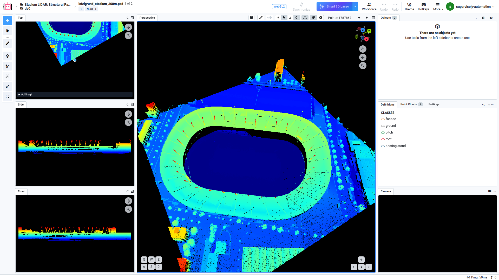

# Stadium LiDAR: Structural Parts

Airborne LiDAR point clouds of a football stadium and the city blocks around it, ready to split into roof, seating stands and pitch.

## Overview

This sample project contains two point clouds cut from one 1 km² swissSURFACE3D tile of Zurich (tile 2680-1248, 2024), which holds the Letzigrund stadium:

- `letzigrund_stadium_300m.pcd`: a 300 × 300 m crop around the stadium at full density, 1,787,867 points;
- `tile_2680-1248_overview.pcd`: the whole 1 km² tile, randomly thinned to 2,160,485 points (1 in 12), to show how small the stadium is within it.

Each point has `x`, `y`, `z` and `intensity`. The project has five classes with the **Point Cloud** shape (`roof`, `seating stand`, `pitch`, `facade`, `ground`) and no labels.

The data is airborne: it shows the roof, stands, pitch and facades from above, not floor slabs, parking levels or undersides.

Use it to:

- split a stadium-scale scan into structural parts, each kept as one point-level object;
- try the Point Cloud Pen, the Top, Side and Front views and the Area of Interest on a dense structure.

## How to Use This Project

1. Click **Get project** in the Supervisely Ecosystem.
2. Open the `ds0` dataset in the 3D Point Cloud Editor.
3. Open `letzigrund_stadium_300m.pcd`, choose a class and label the roof, a stand and the pitch with the Point Cloud Pen.
4. To work with the full-resolution 1 km² tile as an octree cloud, download it from swisstopo (link below) and import it from Team Files with **Import Large Point Clouds (Octree)**.

See the complete workflow in [Annotate Stadium-Scale Point Clouds with Octree Geometry](https://docs.supervisely.com/use-cases/stadium-point-cloud-octree-annotation).

## Download

Download the project in Supervisely format: [project.zip](https://github.com/supervisely-ecosystem/stadium-lidar-octree-annotation/releases/download/v1.0.0/project.zip).

## Dataset Source and License

The point clouds come from **swissSURFACE3D** by the Federal Office of Topography swisstopo, tile 2680-1248 (2024): [swissSURFACE3D](https://www.swisstopo.admin.ch/en/height-model-swisssurface3d), [original tile (COPC LAZ)](https://data.geo.admin.ch/ch.swisstopo.swisssurface3d/swisssurface3d_2024_2680-1248/swisssurface3d_2024_2680-1248_2056_5728.copc.laz).

They are used under the [swisstopo terms of use for free geodata and geoservices (OGD)](https://www.swisstopo.admin.ch/en/terms-of-use-free-geodata-and-geoservices): the data may be used, distributed, processed and used commercially, with a mandatory source reference.

Citation:

> ©swisstopo — swissSURFACE3D, Federal Office of Topography swisstopo, tile 2680-1248 (2024).

Changes:

- Converted from COPC LAZ 1.4 (25,925,830 points) to binary PCD with the fields `x`, `y`, `z` and `intensity`; the other attributes, including the swisstopo point classification, were dropped.
- `letzigrund_stadium_300m.pcd`: points within E 2,680,274–2,680,574 and N 1,248,410–1,248,710 (LV95), all kept.
- `tile_2680-1248_overview.pcd`: a random 1-in-12 subsample of the whole tile.
- Both files are shifted by E −2,680,500 m and N −1,248,500 m (LV95, EPSG:2056) to keep float precision; heights (LN02, m) are unchanged. Add the offset back to get the original coordinates.
- Five empty classes were added; there are no annotations.
